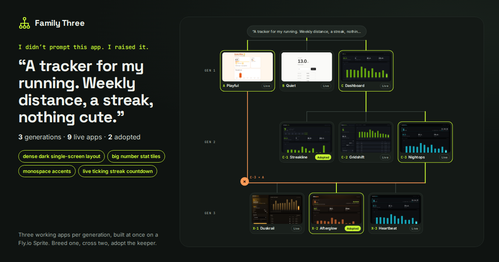
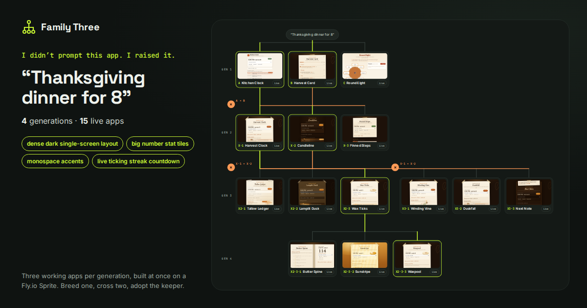

# Family Three

**Apps you raise, not prompt.** A personal agent on a [Fly.io Sprite](https://fly.io/sprites).

Say what you want. Three working apps come back, each on its own link. Pick the one you like and it breeds three more. Cross two to mix them. When one is right, adopt it: it gets a public link, its own GitHub repo whose commits are its ancestors, and a design kit you can reuse anywhere.



- **See it live:** https://ft-family-b6ykp.sprites.app
- **Vote on the crowd's family** (no account): https://ft-family-b6ykp.sprites.app, or tap a button in [t.me/familythreecrowd](https://t.me/familythreecrowd)
- **An adopted app and its family line:** [family-three-afterglow](https://github.com/exbald/family-three-afterglow) (a cross, so its history has a merge commit) and [family-three-streakline](https://github.com/exbald/family-three-streakline)

Built in a week for Fly.io's Hacksgiving 2026. The first commit here is from November 24.

## Why

Most people can't describe the app they want. They know it when they see it. So Family Three shows you three and lets you choose, and every choice teaches it a little more about your taste.

## How it works

1. **Ask.** One sentence, like "a tracker for my running".
2. **Three are born.** A breeder writes three briefs that differ on purpose (one changes the layout, one the mood, one adds a feature). Three Claude Code builders work at the same time, each in its own folder, and write plain HTML, CSS and JavaScript. Headless Chrome opens every new app; if it throws an error, the same builder gets one round to fix it.
3. **Pick.** Breed from the one you like, or cross two: the first gives the structure, the second the look. Each pick updates `taste.md` (what you like, what you passed over), and the next family starts from it.
4. **Adopt.** The keeper gets a short public path on the Sprite, a public GitHub repo with one commit per ancestor (a cross is a merge commit with two parents), GitHub Pages, and a design kit: `DESIGN.md`, `tokens.css`, `tokens.json` and a preview page, taken from the app's real CSS.

5. **Grow it up.** The owner can give an adopted app its own Sprite, `ft-app-<name>`. The agent turns it into a small full-stack app (a plain Node server and a SQLite database through `node:sqlite`, no packages), tests a full round trip through its API, moves it in, starts it as a Sprite service with a public URL and checks it in headless Chrome. The server code is committed to the repo under `grown-up/`. Everyone who opens it now sees and edits the same data.

The Sprite saves a checkpoint after every generation and every adoption. Restore rewinds the whole computer in about eight seconds.

## The crowd's family



Some families have no owner at the wheel (five right now, from Thanksgiving dinner to a kids'-table game). Anyone can vote for the kid that breeds next, on the website (one vote per round per browser, no account) or with the buttons under each post in the Telegram channel (one per account). The first vote starts a 15-minute clock; when it runs out, the leader breeds. If nobody votes for two hours, the agent picks using the crowd's taste so far and says why, at most twice in a row; then it waits for a real vote.

New crowd families start on a clock: every two hours the agent invents one (a different kind of app from the existing families, right for the season) and raises it, up to ten active crowd families, never while kids are being built (`seedEveryMinutes`, `maxCrowdFamilies`). Every family is on the dashboard at `/families`, with its newest apps and what is happening now; the landing has a live clock for the next breed and a ballot where each option is a big card you can open before you vote. Voters only choose among apps the agent already made; nobody types prompts.

## How it runs

Family Three has its own Fly org. One Sprite, `ft-family`, runs everything: a plain Node server (no framework, no dependencies) serves the pages, the API and every child app, and runs as a Sprite service so it comes back after a checkpoint restore.

| Connector | Used for |
|---|---|
| Custom API → Z.ai (Anthropic-compatible endpoint) | The model behind every builder and the breeder. Claude Code points `ANTHROPIC_BASE_URL` at the gateway; the gateway adds the key. |
| GitHub | Adopt: create the repo and write its family line. The connector may only call `POST /user/repos` and `/repos/<owner>/family-three-*`. |
| Custom API → Telegram Bot API | The crowd channel. The bot token rides in the URL path, added by the gateway. There is also a Telegram Mini App (`t.me/FamilyThreeCrowdBot/app`, the bot's Open button, and an Open in the app button on every round): the whole site inside Telegram, starting on the families dashboard or on the family a link names, with the big-card ballot, Telegram's back button and haptics. Votes there count once per Telegram account, the same as the channel buttons; the server checks Telegram's Ed25519 signature on the launch data with Telegram's public key, so it needs no bot token. The owner can also run things from a private chat with the bot: `/new <sentence>` starts a private family, `/new crowd <sentence>` a crowd family, `/seed` has the agent invent one now, `/pause` and `/resume` stop and restart voting, and any other message gets a status of every crowd family. |
| Ollama (optional) | A backup model for the breeder and the autopilot's pick: when the main model call fails, they ask Ollama Cloud (`glm-5.3-flash` by default, `ollamaModel` in `~/.ft/config.json`). The installer finds the connector by itself. Needs credits on your Ollama account; the builders keep using Claude Code, because the Ollama connector doesn't offer the Claude-style endpoint. |

All three are limited to Sprites whose name starts with `ft-`, so the model, GitHub and Telegram keys never sit on the Sprite.

The one key on `ft-family` is for growing apps up. Fly won't let a connector call the Sprites API itself, so this one is a Sprites token, and Fly scopes it: it only works on Sprites whose name starts with `ft-app-`, at most 10 of them, and it expires. It can't touch `ft-family` or anything outside Family Three's org.

Only the owner can raise, breed, cross or adopt: the owner unlocks a browser once with a private link. Everyone else can look at every family and open every app.

```
server/
  index.mjs        routes: pages, API, child apps (/n/<id>/), adopted apps (/a/<name>/)
  generation.mjs   a litter: briefs, three builders at once, browser check, checkpoint
  breeder.mjs      three briefs + taste.md, one model call through Claude Code
  builder.mjs      one headless Claude Code run per child, with overload retries
  thumbs.mjs       headless Chrome: screenshot and script errors
  adopt.mjs        GitHub repo whose commits are the family line
  kit.mjs          design kit from any finished app
  growup.mjs       grow it up: own Sprite, Node server, SQLite
  votes.mjs        crowd voting, the round clock, autopilot
  seeder.mjs       a new crowd family every two hours, up to a cap
  telegram.mjs     the crowd channel
  checkpoints.mjs  Sprite checkpoints and restore
public/            the pages: plain HTML, CSS and JavaScript
scripts/           install.sh, deploy.sh, connector setup
```

## Raise your own

You need a Fly.io Sprite where Claude Code works, either logged in or pointed at a model through a connector.

```bash
sprite create my-family
sprite console
curl -fsSL https://raw.githubusercontent.com/exbald/family-three/main/scripts/install.sh | bash
```

The installer fetches the app, installs headless Chrome, checks the model, finds a GitHub connector if you have one, starts the service, saves a checkpoint and prints your owner link. To use a model connector instead of a Claude Code login:

```bash
curl -fsSL …/install.sh | FT_MODEL_BASE_URL=https://api.sprites.dev/v1/gateway/custom_api/<id> FT_MODEL=<model> bash
```

Your Sprite URL is private to your Fly organization until you run `sprite config update --url-auth public -s <sprite>`.

## Limits

The apps are small single-page tools that keep their data in the browser (localStorage). No accounts, no sync between devices. A first generation takes 1 to 9 minutes per app; breeding is faster because each child starts from its parent's code.
